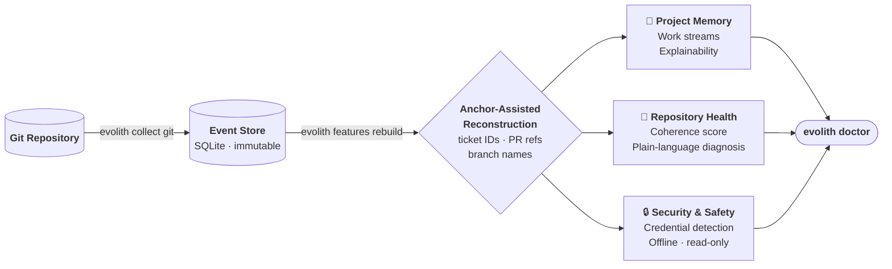

<div align="center">
  
  <br/><br/>

  
  
  
  
</div>

# Evolith

> A Project Memory Doctor for your repository.

Evolith tells you what your repository's history means, whether it's healthy, and whether anything is at risk — all from a single command, entirely offline.

---

## The Problem

Your git log tells you *what* changed, not *what was built*:

```
$ git log --oneline

a67bae4 chore: add python to .gitignore
623bb8b Merge remote-tracking branch 'origin/feature/backend-auth'
70ff7fb Ignore local environment files
98bed6f feat: AI analysis module
36c677f fix: resolve react setState hydration warnings
b5ae8af fix: move health route before fastify ready
6e8aaab lint fixed
5d0dd65 Merge pull request #6 from VaibhavDataSci/main
b6ccf66 Fix: Added dependency path and working directory
ba0e0b0 Feat: Backend CI
02be77e Added security module and backend necessities
... 52 more commits
```

Evolith reconstructs the story behind those commits:

```
$ evolith doctor

Security Alert
==============

⚠  [HIGH]  Database URL with credentials detected in BACKEND_GUIDE.md

Risk: High

Repository Health: Moderate

Your project contains 63 commits grouped into 21 work streams.
7 work streams remain ambiguous due to weak commit signals.

Recommended Actions
1. Move the database credentials in BACKEND_GUIDE.md to environment variables.
2. Use `git filter-repo` or BFG Repo Cleaner to purge secrets from git history.
3. Prefer larger coherent commits over many single-file micro-commits.

Expected Result
Reduced credential exposure risk, fewer ambiguous work streams.
```

```
$ evolith features list

 #   Name               Health          Commits
 ─────────────────────────────────────────────────
  0  Pattern session    Weak Evidence       1
  1  PR PR-3            Weak Evidence       1
  2  Pattern interview  Weak Evidence       2
  3  Episode Candidate  (no anchor)         3
  4  Pattern auth       Weak Evidence       2
  5  Pattern ci         Weak Evidence       5
  6  Branch auth        Weak Evidence       2
  7  PR PR-6            Weak Evidence       1
  8  Pattern frontend   Weak Evidence       1
  9  Branch aiml        Weak Evidence       3
 10  Pattern backend    Weak Evidence       2
 11  PR PR-5            Weak Evidence       4
     ... +10 more
```

---

## How it works



---

## Three pillars

<table>
<tr>
<td align="center" valign="top" width="33%">

### 🧠 Project Memory

What was built?

How did it evolve?

Which work streams are identifiable vs. ambiguous?

```bash
evolith features list
evolith features explain <id>
```

</td>
<td align="center" valign="top" width="33%">

### 🏥 Repository Health

Is the history understandable?

Are commits coherent?

Where is fragmentation happening?

```bash
evolith doctor
evolith doctor --json
```

</td>
<td align="center" valign="top" width="33%">

### 🔒 Security & Safety

Did secrets leak into git?

Are credentials or keys tracked?

What needs immediate action?

```bash
evolith doctor --security
```

</td>
</tr>
</table>

GitHub answers: *what changed?*
Evolith answers: *what happened, is it healthy, and what's at risk?*

---

## Quick start

```bash
git clone <repo-url>
cd evolith
cargo build --release

# Point at any git repository
cd /path/to/your/project
evolith init
evolith collect git
evolith features rebuild

# Get the full picture
evolith doctor

# Security scan only — no feature run required
evolith doctor --security
```

## Core commands

```bash
# Collect and reconstruct
evolith collect git
evolith features rebuild

# Explore work streams
evolith features list
evolith features explain <feature-id>
evolith features explain <feature-id> --json

# Diagnose
evolith doctor
evolith doctor --security
evolith doctor --json

# History
evolith runs list
evolith runs show 0
```

All commands support `--json` for scripting and CI pipelines.

---

## What `evolith features explain` shows

```
$ evolith features explain <auth-feature-id>

Feature: Pattern auth

Feature Health:     Weak Evidence
Anchor Confidence:  0.85
Evidence Strength:  Weak (0.20)

Evidence:
  - 2 commits
  - 2 episodes
  - Branches: feature/backend-auth

Why grouped:
  Strong anchor agreement: 100% of events align to a dominant anchor.
  Limited evidence available.
```

Every work stream is fully explainable — you always know *why* Evolith grouped commits together.

---

## Security scanning

`evolith doctor --security` scans currently tracked files and reports:

| Finding | Severity |
|---|---|
| `.env`, `.env.production`, `.env.local` tracked by git | High |
| Private key files (`id_rsa`, `*.pem`, `*.key`, `*.p12`) | Critical |
| API key patterns — OpenAI, GitHub tokens, AWS, Google, Slack | High |
| Database URLs with embedded credentials | High |
| `.env.example` / `.env.sample` without real values | Medium |
| Missing `.gitignore` rules for common sensitive paths | Medium |

Findings are ranked **Critical / High / Medium**. No network calls. No uploads. No modifications.

---

## Alpha scope (`v0.1.0-alpha`)

**What works:**

- Git event collection (idempotent)
- Anchor extraction — ticket IDs, PR refs, branch names
- Feature reconstruction with confidence scoring
- Run metrics and explainability (text + JSON)
- `evolith doctor` — weighted health scoring, plain-language output, severity-adaptive ordering
- `evolith doctor --security` — offline credential and secret detection
- Validated on multiple real repositories

**Known limitations:**

- Git is the only collected signal source today
- Sparse histories with low anchor density can fragment features
- Monorepo project boundaries are not first-class yet

---

## Repository layout

<details>
<summary>Show project structure</summary>

```
crates/
  cli/             — commands, doctor, security scanning
  event-store/     — SQLite persistence, migrations
  session-engine/  — session reconstruction
  replay-engine/   — feature reconstruction algorithm
docs/
  rfcs/            — RFC-001 through RFC-007
  research/        — alpha feedback, validation artifacts
```

</details>

## Contributing

- `docs/rfcs/RFC-001-event-model.md` — event model
- `docs/rfcs/RFC-006-repository-health-recommendations-engine.md` — doctor scoring
- `docs/rfcs/RFC-007-security-and-safety-scanning.md` — security design
- `CONTRIBUTING.md`

## License

MIT
