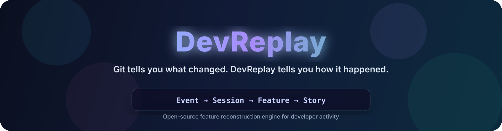
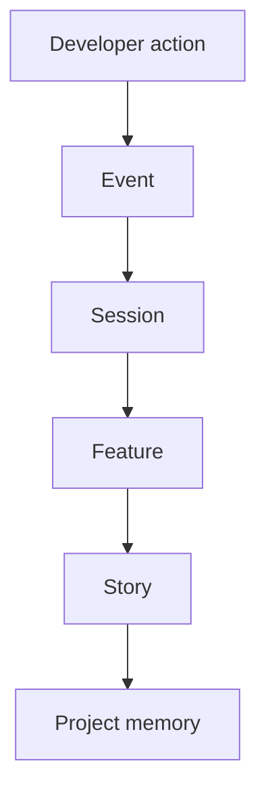
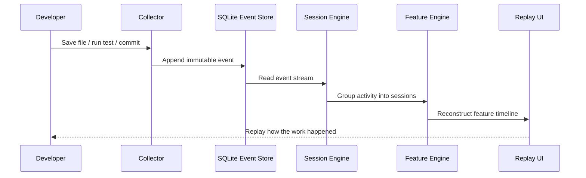
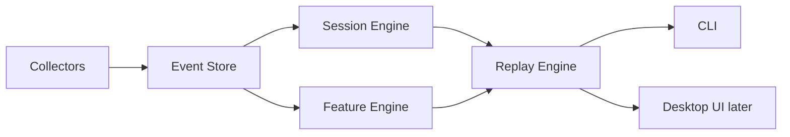

<div align="center">



<br><br>


</div>

# DevReplay

> **Git tells you what changed. DevReplay tells you how it happened.**

DevReplay is an open-source **feature reconstruction engine** for developer activity. It records immutable development events, reconstructs sessions and features from those events, and replays the story of how software was built.

---

## Why DevReplay exists

Modern development lives across Git, the terminal, the editor, tests, and local tooling. Git tells you the final diffs, but it does not preserve the reasoning trail that led there.

DevReplay is built around one idea:

- **Events** are facts
- **Sessions** are projections
- **Features** are projections
- **Stories** are projections

That separation matters because it keeps the raw truth intact while allowing the project history to be reconstructed later.

---

## Core model



### The hierarchy

- **Event** — an immutable fact about a developer action
- **Session** — a contiguous period of activity derived from events
- **Feature** — a grouped slice of work reconstructed from sessions and events
- **Story** — a readable explanation generated from the feature history
- **Project** — the aggregate memory of the codebase

---

## How it feels in practice



---

## Current vision

The project is designed to grow in layers:

### Milestone 0
- Event storage
- Session reconstruction
- CLI replay

### Next layers
- Feature reconstruction
- Multi-assignment history
- Story generation
- Team mode
- Desktop UI

---

## What makes it different

DevReplay is not trying to be another Git GUI or another dashboard.

It is trying to answer different questions:

- Why was Redis added?
- What changed before the test suite broke?
- Which files belonged to the authentication rewrite?
- How did this feature evolve over time?
- What happened between the commit and the bug?

That is why the project is built on event sourcing first.

---

## Architecture



### Repository layout

```text
devreplay/
├── docs/
│   ├── adr/
│   └── rfcs/
├── crates/
│   ├── event-store/
│   ├── session-engine/
│   ├── replay-engine/
│   └── cli/
├── samples/
└── LICENSE
```

---

## Tech stack

- **Rust** for the core engine
- **SQLite** for local-first storage
- **Serde** for structured event data
- **Clap** for the CLI
- **Tauri + React** later for the desktop client

Rust is a strong fit because DevReplay is a local, long-running systems tool that needs safe concurrency, fast queries, and small binaries.

---

## Development philosophy

DevReplay follows a strict rule:

> **Never store a derived truth as if it were raw truth.**

That means:

- Events stay immutable
- Sessions can be rebuilt
- Features can be re-clustered
- Stories can be regenerated
- The underlying history remains auditable

This makes the project easier to improve over time without losing the original data.

---

## Status

This repository is currently focused on the foundation.

### Implemented direction
- Event model
- Event sourcing architecture
- Session projection concept
- Replay-first workflow

### Coming next
- Session persistence
- Feature reconstruction
- Assignment history
- Better replay views

---

## Getting started

```bash
git clone <repo-url>
cd devreplay
cargo build
```

Then:

```bash
devreplay init
devreplay import samples/sample-events.json
devreplay events list
devreplay sessions rebuild
devreplay replay session <id>
```

---

## Contributing

Read these first:

- `docs/adr/ADR-001-why-event-sourcing.md`
- `docs/rfcs/RFC-001-event-model.md`

If you are contributing code, start with the core crates before adding collectors or UI.

---

## License

MIT License.