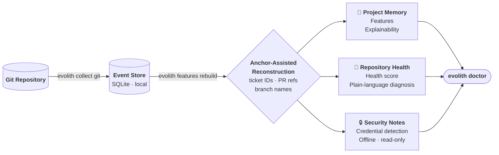

<div align="center">
  
  <br/><br/>

  [](https://github.com/thulasiramk-2310/Evolith/releases/latest)
  
  
  
  
</div>

# Evolith

> **A Project Memory Doctor for your repository.**
>
> One command. Tells you what was built, whether your history is understandable, and whether anything is at risk — entirely offline.

---

## Install

No Rust. No Cargo. No build step.

**macOS (Apple Silicon)**
```bash
curl -fsSL https://github.com/thulasiramk-2310/Evolith/releases/latest/download/evolith-macos-arm64.tar.gz | tar -xz
sudo mv evolith /usr/local/bin/
```

**Linux (x64)**
```bash
curl -fsSL https://github.com/thulasiramk-2310/Evolith/releases/latest/download/evolith-linux-x64.tar.gz | tar -xz
sudo mv evolith /usr/local/bin/
```

**Windows (x64)**
1. Download [`evolith-windows-x64.zip`](https://github.com/thulasiramk-2310/Evolith/releases/latest/download/evolith-windows-x64.zip)
2. Unzip
3. Move `evolith.exe` to a folder in your PATH (e.g. `C:\tools\`)

Verify:
```bash
evolith --version
```

---

## Quick start

```bash
cd your-project        # any git repo

evolith init           # set up Evolith (takes 1 second)
evolith collect git    # read your commit history
evolith features rebuild  # reconstruct what was built
evolith doctor         # get the full health report
```

That's it.

---

## What you'll see

### `evolith doctor`

```
Project Memory
────────────────────────────────────────────────

Your project has 63 commits across 21 features.

  ✓  14 features are clearly identified
  ⚠  7 features have limited or unknown history

Repository Health:  Room to Improve

────────────────────────────────────────────────

Security Notes

  ⚠  Needs Attention  Database URL with credentials detected in BACKEND_GUIDE.md

────────────────────────────────────────────────

What To Do

  1. Move the database credentials in BACKEND_GUIDE.md to environment variables.
  2. Use git filter-repo or BFG Repo Cleaner to remove secrets from git history.
  3. Include ticket IDs in commit messages (e.g. AUTH-123, PROJ-42).

Expected Result

  Reduced credential risk and a clearer, more complete project history.

────────────────────────────────────────────────

Details
────────────────────────────────────────────────
  Identity Coverage:      38.1%
  Feature Consistency:    0.61
  Identified Features:    14
  Unknown Features:       7
  Avg Commits / Feature:  3.00
```

### `evolith features list`

```
Your project has 21 identified features.

   1.  AUTH-123: migrate jwt flow              [active]
   2.  Pattern auth                            [active]
   3.  PR PR-6: backend CI setup               [active]
   4.  Branch frontend                         [active]
   5.  Pattern aiml                            [active]
       ... +16 more
```

### `evolith features explain <id>`

```
AUTH-123: migrate jwt flow
──────────────────────────────────────────────────

What happened?
  3 commits  ·  4 file changes  ·  linked to AUTH-123  ·  on feature/auth-refresh

Why it matters
  This feature is clearly identified — 83% of its commits point to the same
  feature. Evolith can reliably trace this back through your history.

What to do
  Nothing — this feature is in good shape.

Expected result
  Your project memory for this feature is reliable.

──────────────────────────────────────────────────
Identity Clarity:   Strong
History Strength:   Strong
Commits:            3
Work sessions:      2
Linked to:          AUTH-123  ·  feature/auth-refresh
```

---

## The problem it solves

Your git log tells you *what* changed — not *what was built*:

```
$ git log --oneline

a67bae4 chore: add python to .gitignore
623bb8b Merge remote-tracking branch 'origin/feature/backend-auth'
70ff7fb Ignore local environment files
98bed6f feat: AI analysis module
36c677f fix: resolve react setState hydration warnings
b5ae8af fix: move health route before fastify ready
6e8aaab lint fixed
5d0dd65 Merge pull request #6 from VaibhavDataSci/main
... 52 more commits
```

Evolith reads this history and answers three questions:

| Question | Command |
|---|---|
| What was actually built? | `evolith features list` |
| Is the history understandable? | `evolith doctor` |
| Did anything sensitive leak? | `evolith doctor --security` |

---

## How it works



No network calls. No uploads. Everything stays on your machine.

---

## All commands

```bash
# Setup
evolith init
evolith collect git

# Understand your project
evolith features rebuild
evolith features list
evolith features explain <feature-id>
evolith features explain <feature-id> --json

# Health and security
evolith doctor
evolith doctor --security
evolith doctor --json

# History
evolith runs list
evolith runs show 0
```

All commands support `--json` for scripting and CI pipelines.

---

## Security scanning

`evolith doctor --security` scans your tracked files and reports:

| What it finds | Severity |
|---|---|
| `.env`, `.env.production`, `.env.local` in git | Needs Attention |
| Private key files (`id_rsa`, `*.pem`, `*.key`) | Secrets Exposed |
| API keys — OpenAI, GitHub tokens, AWS, Google, Slack | Needs Attention |
| Database URLs with embedded credentials | Needs Attention |
| `.env.example` / `.env.sample` (template files) | Worth a Look |
| Missing `.gitignore` rules for sensitive paths | Worth a Look |

No network calls. No modifications. Read-only.

---

## Alpha scope (`v0.1.0-alpha`)

**What works:**

- Git event collection (idempotent — safe to run multiple times)
- Anchor extraction — ticket IDs, PR refs, branch names
- Feature reconstruction with confidence scoring
- Health scoring with plain-language output
- `evolith doctor` — weighted scoring, adaptive severity ordering
- `evolith doctor --security` — offline credential and secret detection
- Validated on multiple real repositories

**Known limitations:**

- Git is the only collected signal source today
- Sparse histories with low anchor density can produce thin features
- Monorepo project boundaries are not first-class yet

---

## Build from source

Requires [Rust](https://rustup.rs/) 1.75+:

```bash
git clone https://github.com/thulasiramk-2310/Evolith.git
cd Evolith
cargo build --release
# binary at: target/release/evolith
```

---

## Repository layout

<details>
<summary>Show project structure</summary>

```
crates/
  cli/             — commands, doctor, security scanning
  event-store/     — SQLite persistence, migrations
  session-engine/  — session reconstruction
  replay-engine/   — feature reconstruction algorithm
docs/
  rfcs/            — RFC-001 through RFC-007
  research/        — alpha feedback, validation artifacts
```

</details>

## Contributing

- `docs/rfcs/RFC-006-repository-health-recommendations-engine.md` — doctor scoring
- `docs/rfcs/RFC-007-security-and-safety-scanning.md` — security design
- `CONTRIBUTING.md`

## License

MIT
