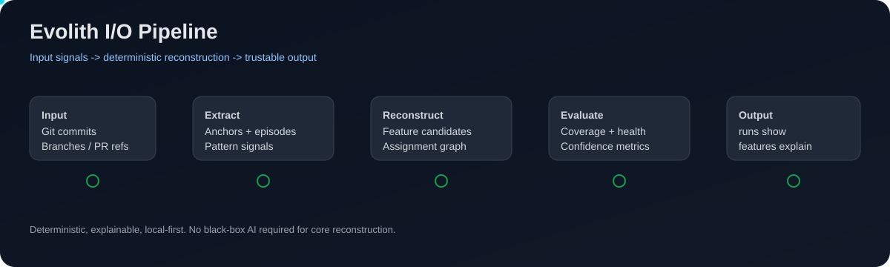

<div align="center">
  
  <br/><br/>

  
  
  
  
</div>

# Evolith

> Git tells you what changed. Evolith reconstructs, explains, and evaluates how it happened.

Evolith is a local-first developer intelligence engine that turns raw activity into explainable feature history.

## Animated I/O Flow

<div align="center">
  
</div>

## At a Glance

- Collects immutable development events (`git` today)
- Reconstructs sessions and features from those events
- Persists assignments and run history in SQLite
- Scores reconstruction trust with deterministic metrics
- Explains every feature and every run in both text and JSON

## Workflow

```text
Git History
  -> Event Collection
  -> Anchor Extraction (ticket/branch/PR/pattern)
  -> Episode Reconstruction
  -> Feature Reconstruction
  -> Metrics + Health
  -> Explainability (feature + run)
```

## Quick Start

```bash
git clone <repo-url>
cd evolith
cargo build
cargo run --manifest-path crates/cli/Cargo.toml --bin evolith -- init
```

## Core Commands

```bash
evolith init
evolith collect git
evolith features rebuild
evolith runs list
evolith runs show 0
evolith features list
evolith features explain <feature-id>
```

JSON mode:

```bash
evolith runs show 0 --json
evolith features explain <feature-id> --json
```

Compatibility note: `devreplay` is still available as a deprecated alpha alias.

## Why Teams Use It

Evolith is built for questions Git cannot answer directly:

- What were the real work streams behind the last month of commits?
- Which reconstructed features are trustworthy vs weakly supported?
- How much of repository history is anchor-driven vs heuristic fallback?
- Where is reconstruction fragmentation happening?

## Trust Model

Evolith separates consistency from evidence volume:

- `Anchor Confidence`: internal anchor agreement
- `Evidence Strength`: amount of supporting activity
- `Feature Health`: healthy / weak / fragmented / conflicting signals
- `Run Health`: quality summary at full reconstruction-run level

## Alpha Scope (`v0.1.0-alpha`)

- Git collection
- Feature reconstruction pipeline
- Run tracking and metrics
- Explainability and trust outputs
- Real repository validation artifacts

Known limitations:

- Git is currently the only collected signal source
- Sparse histories with low anchor density can fragment
- Multi-project monorepo boundaries are not first-class yet

## Repository Layout
<details>
<summary>Show project structure</summary>

```text
crates/
  cli/
  event-store/
  session-engine/
  replay-engine/
docs/
  adr/
  rfcs/
  research/
research/
  adversarial/
  reports/
samples/
```
</details>

## Contributing

Start here:

- `docs/adr/ADR-001-why-event-sourcing.md`
- `docs/rfcs/RFC-001-event-model.md`
- `CONTRIBUTING.md`

## License

MIT
